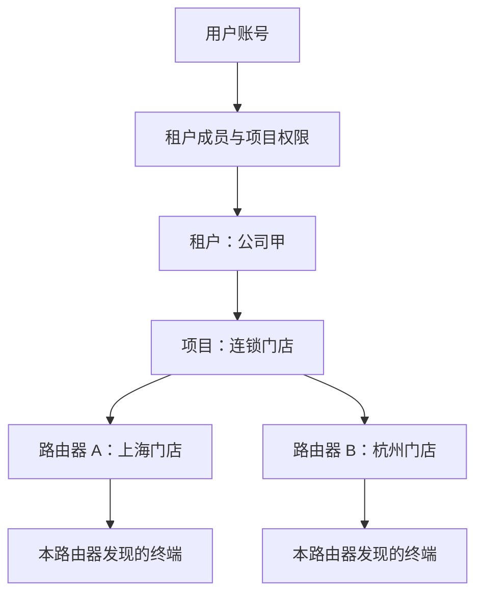
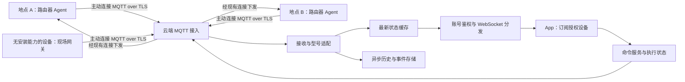

# LabProbe 多租户云端方案

日期：2026-10-08。本文为设计与容量估算，没有部署或修改现有 App、Hub、Agent。

## 适用规模与建议

用户已确认：约 50 个用户，每人平均两台路由器，共约 100 台；设备可以分属多个租户、多个项目，并处于不同网络。用户偶尔查看 App，使用时间错开。现有服务器为 N100、16 GB 内存、公网 20M。以下按 20 Mbps 公网出口计算；若线路限速同时约束收发总量，应把入口和出口分别测量后一起核对。

建议采用一个共享的云端系统，路由器上运行 LabRelay Agent，设备主动建立加密长连接。云端管理账号、权限、项目、最新状态、历史和命令。手机通过自己的账号访问云端，用一条 WebSocket 按需订阅有权限的设备。50 个账号不会自动产生 50 份采集任务。

这台服务器适合作为上述规模的首期配置。20 Mbps 在偶尔查看、精简遥测的假设下有较大余量。CPU、内存和磁盘是否满足实际功能组合，仍须通过负载验证，本文不是性能实测。AI 推理、测速流量、视频、VPN 或文件转发的容量不包含在遥测估算内。

## 官方云服务的同步方式与我们的接入方式

已保存的固件取证显示，官方云端通过固件中的 `shinya_mqlink` 云连接通道下发业务指令。设备端收到儿童守护同步命令后执行本地 `dev_sta set -m child_sync`，下载完整配置，调用 `dev_config` 并更新运行时。设备端也通过 `shinya_mqlink.config_notify` 上报配置变化。这里的本地命令由固件服务调用，并不代表云服务器通过 SSH 执行。

因此，官方具备预装在固件里的设备端执行服务、设备接入认证、账号与项目绑定和业务接口。我们的云端也需要这样的设备端代理。现有 LabRelay 已有本地采样和配置执行能力，可以在它上面增加自己的设备认证、长连接、订阅需求和命令协议。日常同步与控制可由 Agent 在路由器内执行，SSH 用于初次安装、升级故障排查等维护。现有 eWeb 模拟登录则逐步由已验证的本地接口代替；尚未适配的功能可以暂时保留为兼容方式。

已有证据只覆盖所取证的功能，不能推定所有官方实时页面都以同一种协议、同一频率工作。儿童统计已确认本地约每 60 秒采集、上传调度周期约 300 秒；名单同步是云端命令触发。这说明官方也按业务区分实时查询、事件和批量历史。

自建云使用自己的设备密钥和用户账号。原固件接入官方云的鉴权及业务接口，不能仅靠把服务器地址替换成我们的地址就完整复用。官方名单下发曾覆盖本地修改，独立儿童守护迁移时，需要明确新名单的唯一管理来源并验证旧同步不会覆盖它；不要据此停掉不相关的固件服务。

来源：[儿童守护云端取证](child-guard-cloud-sync-gap-2026-10-07.md)、[固件内部接口审计](router-firmware-api-audit.md)。

### 是否集成进固件

用户补充的讨论截图描述了 MQTT 长连接、设备端代理封装本地接口，以及将代理集成进固件的想法。这与上述架构相符；截图是讨论材料，未作为刷写或修改设备的授权。

独立安装的 Agent 和固件预装的 Agent 可以使用相同的云端协议。预装的收益主要在安装、自启动、配置持久化和恢复流程。把程序放进固件不会自动补齐本地接口、设备认证、租户权限或命令验证。

可先沿用当前静态二进制与 `procd` 自启动，落实进程异常重启、设备密钥持久化、断线恢复、升级校验和回滚。BE50 与 BE72 按各自 CPU 架构及固件能力发布适配程序。等设备端协议和功能验证稳定，再评估固件构建、签名校验、升级兼容和恢复条件，决定是否预装。当前尚未验证这两台官方固件能够安全重打包和刷写。

设备端接口按功能逐一适配：能稳定读取的本地总线、系统接口和厂商模块直接调用；必须通过厂商命令入口的功能先使用有超时、有限参数的本地调用。即使设备端内部使用命令或脚本，云端仍可只发送 `读取状态`、`设置规则` 等结构化业务请求。MQTT 负责传输，Agent 负责理解请求并执行；必须同时实现这两部分。

## 租户、项目、地点与设备

租户代表一家组织或一个家庭；用户通过成员关系加入租户。一个租户可以有多个成员，一个用户也可以加入多个租户。项目用于业务分组；地点用于说明物理网络。一个项目可以跨多个地点，每台路由器有自己的设备身份和接入连接。

最小业务表：`users`、`tenants`、`tenant_members`、`projects`、`project_members`、`sites`、`devices`、`device_credentials`、`terminals`、`commands`、`events`、`telemetry_1m`。地点是可选字段，不强制增加项目层级。受管设备可扩展为路由器、AP 或网关，通过型号适配器声明能力。

所有业务记录带 `tenant_id`；设备和业务查询同时校验项目授权。设备身份使用稳定的随机 ID，MAC/SN 用于识别而非登录凭证。终端身份至少按所属设备与 MAC 组合，不能把不同网络的同一 MAC 当作一个全局终端。

权限先支持租户管理员、项目管理员、操作员、只读成员。手机传来的租户/项目/设备 ID 只是查询目标，服务器根据账号和注册表验证授权。查询、缓存、历史、任务、告警和实时订阅都执行相同范围约束。设备移交和成员撤权立即使旧订阅失效。

云端 PostgreSQL 保存业务记录，应用查询包含租户约束，并配置行级安全作为额外约束。应用连接使用非表所有者、非超级用户账号，连接池事务内设置并清理租户上下文；项目权限仍须显式校验。参考 [PostgreSQL 行级安全](https://www.postgresql.org/docs/current/ddl-rowsecurity.html)。

## 不同网络如何接入

每台可安装 Agent 的路由器直接连接云端。设备不具备安装能力时，在能访问它的现场网络放一个网关，网关管理明确授权的设备列表。同项目在三个互不连通的地点，则需要三个直接接入点或现场网关；一处网关无法自动访问另两处内网。

私网地址留在本地适配器中。两处网络都使用 `192.168.1.1` 不影响云端区分，因为接入身份是设备 ID。云端通过设备的主动连接下发结构化命令，设备本地执行并回报结果。公网只需允许设备访问云端入口；不要求每台路由器配置公网 IP、端口映射或开放 eWeb/SSH。

设备绑定采用限时、一次性的领取码，并结合本地管理权确认。领取完成后签发每台设备独立、可撤销的密钥或证书。初次上报进入待绑定状态，不能仅凭自报的 MAC/SN 自动加入某个租户。

MQTT topic 可采用稳定设备 ID，例如 `lp/v1/device/{id}/telemetry`、`command`、`ack`、`presence`。每台设备只可写自己的上报与回执、读自己的命令；网关账号仅可访问登记的设备清单。租户与项目归属由云端注册表决定，避免改项目就更换所有 topic。App 使用账号 API 与 WebSocket，设备接入凭证留在设备端。Mosquitto 支持在线管理账号、角色和 topic 权限，见 [Dynamic Security](https://mosquitto.org/documentation/dynamic-security/)。

## 实时数据如何避免拥堵

1. **每台设备只采集一份。** 两个人同时看同一台路由器，设备采集频率保持不变；云端将相同样本分发给两个订阅者。
2. **按查看需求提高频率。** 平时保活与低频摘要；打开路由详情后，路由数值按已验证能力每 1～2 秒更新，终端速率每 2 秒更新。订阅需求按设备合并，最后一个查看者离开后保留约 30 秒缓冲，再恢复低频。项目总览只订阅摘要，不自动订阅全部终端明细。
3. **先更新缓存，再异步写历史。** 手机首屏拿最新状态，之后接收变更；手机显示不等待数据库写入。1 秒级样本保留在短期缓存，长期历史按 1 分钟聚合，终端历史另设更低频率和保留上限。
4. **每个手机有独立的发送任务和有界队列。** 慢手机不阻塞设备接收、其他手机或写库。实时状态按设备和类型合并，旧数值由新值替换；持续超时则关闭该连接，重连重新获取快照。
5. **丢旧状态时保证语义正确。** 若消息是增量，先在缓存合并为最新状态，再产生可恢复的推送；不能任意丢一个增量导致终端消失或保留旧值。配置变化带版本，事件可按游标补取，任务回执另行持久化。
6. **命令有独立的可靠路径。** 高频遥测可用 QoS 0，命令与回执采用 QoS 1；每条命令有 ID、目标设备、期限、幂等检查和执行回读。区分已受理、已送达、已执行、已验证，避免把 MQTT ACK 当作配置成功。危险旧命令超过期限不得在设备上线后重新执行。
7. **限制突发与异常租户。** 每设备限制报文体积和频率，每租户限制请求和订阅量。上线、快照、重连增加随机错峰；全量快照只在首次、成员变化或低频校准发送，批量重连限速。broker 队列同时限制消息数与字节数，参考 [Mosquitto 配置文档](https://mosquitto.org/man/mosquitto-conf-5.html)。

每个手机只需一条 WebSocket，该连接包含多个设备订阅。路由器数量、账号数量、设备订阅数和连接数是不同指标。没有打开 App 的用户不应维持高频手机推送。

## 带宽估算

以下为设计预算，不是生产总流量实测。现有一次 35 秒历史取证中，首个路由数值帧序列化体积为 BE50 399 B、BE72 463 B；预算把路由数值帧扩大为 800 B，并统一按每秒一次计算。终端数量用户尚未指定，默认每台 30 个，同时给出 10/100 个的敏感性估算。

采用十进制 B、GB 和 Mbps，不计算压缩收益，并加 30% 通信开销和重传余量：

| 项目 | 预算体积 | 频率 |
| --- | ---: | ---: |
| 路由数值 | 800 B | 1 秒 |
| 终端速率帧 | 250 + 100 × N B | 2 秒 |
| 终端完整快照 | 500 + 600 × N B | 15 秒 |

`N` 为每台路由器终端数量。完整快照 15 秒采用当前代码的保守预算；新方案可按变化发送，并延长周期校准，从而降低平均流量。终端名字、地址列表和扩展字段会改变报文体积，实施后必须用实际序列化长度替换假设。

每个被实时查看的设备订阅，每秒业务字节为：

`S = 800 + (250 + 100 × N) / 2 + (500 + 600 × N) / 15`

`云端出口 Mbps ≈ 当前设备订阅数 × S × 8 × 1.30 / 1,000,000`

同一台设备被两个人查看，出口按两份设备订阅计算；设备入口仍只需上报一份。对每台 30 个终端，`S ≈ 3,658 B/s`，包含余量后每份订阅约 `0.038 Mbps`。

| 同时使用情景 | 设备订阅数 | 云端实时出口预算 |
| --- | ---: | ---: |
| 2 人，每人看 1 台，30 个终端/台 | 2 | 0.076 Mbps |
| 5 人，每人看 1 台，30 个终端/台 | 5 | 0.190 Mbps |
| 10 人，每人看 1 台，30 个终端/台 | 10 | 0.380 Mbps |
| 50 人，每人看 1 台，30 个终端/台 | 50 | 1.902 Mbps |
| 50 人，每人看 2 台，10 个终端/台 | 100 | 1.933 Mbps |
| 50 人，每人看 2 台，30 个终端/台 | 100 | 3.805 Mbps |
| 50 人，每人看 2 台，100 个终端/台 | 100 | 10.357 Mbps |

建议给遥测与状态预留约 5～10 Mbps 可用出口预算，业务下载和维护流量受限，实际预留量随终端数调整。20 Mbps 下典型偶尔查看的流量很低；上述 100 终端极端行已接近 10 Mbps，需要避免同时大文件下载。

如果 50 人每天各查看 10 分钟、每次只查看一台且每台 30 个终端，稳态遥测约 **4.3 GB/月出口**；每次两台约 **8.6 GB/月**。冷启动配置、历史查询、App/Agent 更新和其他业务另计。这比 100 份订阅全天不间断约 1.23 TB/月更符合用户的使用方式。

入口也应单独预算：如果 100 台全部持续使用同样的实时格式，约 3.8 Mbps 入站，不应乘以查看人数。按需上报可明显降低空闲入口。例如路由摘要每 10 秒、终端数值每 30 秒、完整快照每 5 分钟，30 个终端时约 0.26 Mbps 总入口，加心跳与控制余量可按 0.2～0.5 Mbps 起算。该空闲周期是方案建议，不是当前已上线行为。

100 台设备同时重连，各发 18.5 KB 终端快照，会产生约 1.85 MB 的业务突发；需分散重连、限制首屏快照速率。一个租户项目里展示全部 100 台设备终端详情、多人同时共享全部设备、遥测字段大幅膨胀等情景须重新计算。

## 首期部署与现有项目迁移

一台服务器可用 Docker Compose 管理：公网 HTTPS/WSS 入口、MQTT broker、共享账号与业务服务、接收/分发任务进程、PostgreSQL、Redis。数据库和 Redis 只在服务网络内访问。启用日常备份、日志轮转和告警，单机故障时全平台会短暂不可用，恢复目标通过备份和恢复演练确定。

无需按租户创建完整 Hub。共享业务服务维护设备会话，每设备拥有轻量状态和命令队列。现有多路由模式为每台路由启动独立 Hub worker、使用独立 SQLite 和令牌，适合少量自有路由的兼容部署；扩展到约 100 台时，宜作为迁移桥接，而不是长期复制 100 个单路由运行环境。

现有可复用项：Rust Agent 本地读取与执行、设备解析、型号能力表、App 数值显示、Hub WebSocket 帧与缓存思路。需要新增或改造的核心项：用户登录、租户与项目授权、设备领取与独立鉴权、Agent 出站长连接、按设备合并查看需求、共享最新状态、可靠命令和跨租户订阅验证。

现有 App 使用 Hub `APP_TOKEN`，云版改为账号登录取得会话；由云端返回授权的租户、项目和设备列表。现有单路由帧需加入设备身份，App 以设备 ID 分别管理缓存。不要只给现有 API 加一个 `tenant_id` 参数就开放多租户。

现有 Hub 使用线程式 Flask 服务，实时状态和订阅者主要在进程内。部署共享云端时使用适合长连接的运行方式，把公共最新状态放入 Redis，明确接收进程与分发进程职责；不能简单启动多个旧 Hub 进程并假定它们共享内存缓存。WebSocket 反向代理须配置升级请求头和心跳/超时，见 [Nginx 官方说明](https://nginx.org/en/docs/http/websocket.html)。

推荐顺序：

1. 在 BE50、BE72 上验证各一台 Agent 主动连测试云；确保云端不访问设备 eWeb/SSH，也能读路由摘要、终端列表并执行一项可回读的配置。
2. 增加租户、项目、成员和绑定；测试跨租户拒绝、同项目异地接入、重叠内网 IP 和设备移交。
3. 完成 App 账号登录与设备订阅；落实低频/实时切换、独立慢客户端队列、断线恢复和可靠命令。
4. 先接 5～10 台真实设备，观察报文体积、数据新鲜度、路由器负载及服务器资源，再扩到 100 台。

## 上线验收

测试组合包括 100 台设备接入、50 个 App 连接、100 份实时设备订阅、弱网手机、一个设备采样卡住、数据库暂时变慢、批量重连和跨租户访问。目标是弱网和故障只影响相关连接；正常客户端仍收到最新样本，命令状态可恢复，CPU/内存/磁盘没有持续增长，真实线路流量在预算内。

数值实时目标建议按数据源频率设定：支持 1 秒采样的字段，在正常网络下多数样本到 App 后年龄小于 3 秒；2 秒采样的字段使用相应窗口。分别记录设备采样、云端接收、App 接收与命令回读时间，避免用不同机器的未校准墙钟直接判定延迟。

首期无需为 100 台设备引入复杂集群。先验证设备适配与权限边界，再根据实际瓶颈扩容。按一分钟保存每台路由器一条聚合历史，100 台约 14.4 万条/天；终端明细另外计量，设置保留期、索引和清理任务。

## 本地代码依据

- [当前多路由部署](../MULTI_ROUTER.md)：按路由 worker、SQLite 和令牌隔离；MQTT topic 权限的既有局限。
- [实时分发实现](../hub_realtime_ws.py)：8 条客户端队列、非阻塞入队、精简终端字段、15 秒完整快照预算。
- [路由实时聚合](../router_core/realtime/router_realtime.py)：快流与 Agent 样本合并、最新内存状态。
- [终端采样](../router_device_live_sync_patch.py)与 [Agent 采样](../labrelay/src/runtime.rs)：终端采样频率及独立采样链路。
- [BE50 本地采样验收](be50-live-eweb-audit.md)：已有 Agent 在本机采集并推送的基础。
